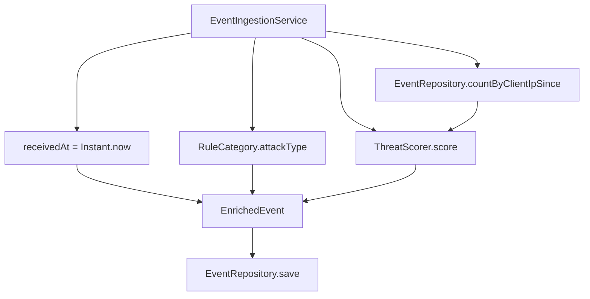

# Enrichment (Part 2)

Every validated event is enriched before it is stored: classify its attack type,
compute a threat score, stamp a server-side receive time, and assemble it into an
`EnrichedEvent`. Enrichment runs inside `EventIngestionService` as the middle stage
of the pipeline (**ingest → enrich → store**); see [`ingestion.md`](ingestion.md) for
how it's invoked.

### Component flowchart



---

## 1. Classification (2.1)

`rule.category` maps to a human-readable `attackType`. The mapping lives **on the
`RuleCategory` enum** (`category.attackType()`):

| `rule.category` | `attackType` |
|---|---|
| `INJECTION` | SQL/Command Injection |
| `XSS` | Cross-Site Scripting |
| `PROTOCOL_VIOLATION` | Protocol Anomaly |
| `DATA_LEAKAGE` | Data Exfiltration |
| `BOT` | Bot Activity |
| `DOS` | Denial of Service |
| `RATE_LIMIT` | Rate Limiting |

On the enum because it's a stable identity/label, cohesive, and exhaustive by
construction (a new category can't exist without a label).

---

## 2. Threat score (2.2)

Computed by `ThreatScorer.score(event, recentEventsFromSameIp)` — a **pure function**;
the recent-IP count is supplied by the caller (the service queries the store).

```
score = severityWeight + actionWeight + pathBonus + repeatOffenderBonus   (capped at 100)
```

| Component | Rule |
|---|---|
| severity | CRITICAL 40 · HIGH 30 · MEDIUM 20 · LOW 10 |
| action | DENY +20 · ALERT +10 · MONITOR +0 |
| path bonus | +15 if `path` contains `/admin` or `/login` |
| repeat-offender | +15 if **more than 5** events from the same `clientIp` within the last 10 minutes |
| cap | min(score, 100) |

- **Repeat-offender** uses the store: `EventRepository.countByClientIpSince(clientIp,
  now − 10min)`, counting by server-assigned **`receivedAt`** (not the client's
  `timestamp` — zero-trust). More than 5 prior stored events → +15.
- **Documented assumption:** the spec's "more than 5 … within the last 10 minutes" is
  read as *strictly > 5 prior stored events*, so the 7th+ rapid request from an IP is flagged.
- The reachable range is **10–90** (so `min(…, 100)` never fires with these weights — kept
  as a defensive, spec-faithful guard).

---

## 3. The enriched record (2.3)

`EnrichedEvent` = the original event **plus** the three derived fields:

```java
record EnrichedEvent(@JsonUnwrapped SecurityEvent event,
                     String attackType, int threatScore, Instant receivedAt)
```

- **Composition** (wraps `SecurityEvent`) — no duplicating the original 15 fields.
- **`@JsonUnwrapped`** flattens it in JSON, so the wire shape is "the original fields
  *plus* `attackType`/`threatScore`/`receivedAt`" — matching the spec.
- This is exactly what the store holds and what the ingest endpoint returns.

---

## How it runs inside `ingest`

```
receivedAt      = Instant.now()                              // server-assigned (zero-trust)
recentFromSameIp = repository.countByClientIpSince(clientIp, receivedAt − 10min)
attackType      = event.rule().category().attackType()
threatScore     = threatScorer.score(event, recentFromSameIp)
enriched        = new EnrichedEvent(event, attackType, threatScore, receivedAt)
repository.save(enriched)
```

Within a batch, a later event's repeat-offender count includes earlier same-IP events
from the same batch that were already saved — which is correct.

---

## Worked examples

| Event | Score |
|---|---|
| CRITICAL + DENY + `/api/v1/login`, no repeat | 40 + 20 + 15 = **75** |
| LOW + MONITOR + `/products`, no repeat | 10 + 0 + 0 = **10** |
| MEDIUM + ALERT + `/admin/users` | 20 + 10 + 15 = **45** |
| CRITICAL + DENY + `/login`, 7th from same IP in 10 min | 75 + 15 = **90** |

---

## Components

- `RuleCategory.attackType()` — classification (domain enum).
- `ThreatScorer` (`com.akamai.miniwsa.enrichment`) — the scoring formula; pure.
- `EventRepository.countByClientIpSince(...)` — the repeat-offender lookup.
- `EnrichedEvent` (`com.akamai.miniwsa.domain`) — the enriched record.

---

## Design decisions

- **Whole scoring formula in `ThreatScorer`; count passed in** — cohesive policy, pure/testable
  scorer; the store query is the service's job.
- **`attackType` on the enum** — stable label, exhaustive by construction (contrast: scoring
  weights are tunable *policy*, so they live in the scorer, not on enums).
- **Repeat-offender on server `receivedAt`**, not client `timestamp` — zero-trust.
- **`EnrichedEvent` composition + `@JsonUnwrapped`** — no duplication, flat spec-matching JSON.
- **Idempotent upsert** means replays of one `eventId` can't inflate the repeat-offender count.

---

## Tests

| Test | Covers |
|---|---|
| `RuleCategoryTest` | all 7 `category → attackType` mappings |
| `ThreatScorerTest` | severity/action/path weights; repeat-offender threshold (5 vs 6) |
| `EventIngestionServiceTest` | enrich+store of a valid event; repeat-offender end-to-end; upsert doesn't inflate |
| `InMemoryEventRepositoryTest` | `countByClientIpSince` (IP + time window) |

---

## Status

Part 2 complete. The stored `EnrichedEvent`s are what Part 3 (stats — [`stats.md`](stats.md))
and Part 4 (samples — [`samples.md`](samples.md)) query.
