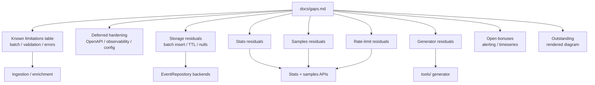

# Gaps & deferred work

Everything consciously **not done yet** — known limitations of current behaviour, deferred
hardening, parts not built, optional bonuses, and outstanding deliverables. Each item is a
deliberate scope choice, not an oversight. Feeds the README's "what I'd improve" section.

### Component flowchart

How this catalog maps onto the system (residuals sit beside finished parts):

## Known limitations (current behaviour)

| # | Area | Current behaviour | Would improve |
|---|---|---|---|
| 1 | Batch | empty batch `[]` → `201 []` (no-op) | reject with `400` |
| 2 | Batch | no max batch size — a 10k-event POST is processed whole | cap size, return `413` past it |
| 3 | Batch errors | transport errors are indexed (`[0].rule.category`), semantic errors are not (`eventId`) | thread the batch index through semantic validation |
| 4 | Batch | intra-batch duplicate `eventId`: response returns both; **in-memory** keeps one (count can diverge); **ClickHouse** stores both rows | dedupe within the batch, or reject; CH: ReplacingMergeTree / upsert |
| 5 | Enrichment | repeat-offender count-then-save isn't atomic → benign under-count under concurrency | atomic count+insert (a real store does this) |
| 6 | Validation | `statusCode` only `@Positive` (999 accepted) | `@Min(100) @Max(599)` |
| 7 | Enrichment | path bonus is a substring match (`/administrator` triggers `/admin`) | match path segments |
| 8 | Validation | no IP-format check (`clientIp:"not-an-ip"` accepted) | validate IPv4/IPv6 |
| 9 | Validation | no timestamp sanity bounds (far-future/ancient accepted) | reject implausible times |
| 10 | Errors | `405`/`415` use Spring's default body, not our `ErrorResponse` | map them into the unified shape |
| 11 | Docs | ingest **body** bad-timestamp message leaks the Java type ("invalid value for Instant"); stats/samples **query** params already use a friendlier message | same friendly wording on the body path |
| 12 | Enums | enum matching is case-sensitive (`"deny"` rejected) | by design; could accept case-insensitively |
| 13 | Stats | missing `from`/`to` → Spring's default 400 body, not `ErrorResponse` | map into the unified shape (same family as #10) |
| 14 | Stats | top-N ties (equal counts) — order may differ in-memory vs ClickHouse | stable secondary sort (e.g. IP/path asc) |
| 15 | Stats | categories/actions with zero events are omitted from maps | emit zeros for all enum values if dashboards need a fixed shape |

## Deferred hardening / nice-to-haves

- **Richer OpenAPI** — only the `201` status is corrected; could add `@Operation`/`@Schema`
  descriptions and example payloads per endpoint.
- **Observability** — no metrics/structured logging/tracing (e.g. Micrometer, request logging).
- **Config** — `clickhouse` profile exists for storage; threat weights / top-N / batch caps are
  still constants in code (not externalised).

## Storage

ClickHouse is now implemented behind the `clickhouse` profile (see `storage.md`); in-memory
remains the zero-infra default. Remaining:
- **Single-row INSERTs** — `save` inserts one row at a time; ClickHouse favours batched inserts for
  throughput. Would batch (and/or async insert) at scale.
- **No retention/TTL** — events accumulate unbounded (ClickHouse `TTL` clauses would help).
- **Null optional fields round-trip as empty strings** in ClickHouse (use `Nullable(...)` for exact).
- **In-memory default is not durable** (lost on restart) — fine for dev; use the ClickHouse profile
  for persistence.
- **No `eventId` upsert on ClickHouse** — plain `INSERT` into `MergeTree`; replays append duplicates
  (in-memory map upserts by id).

## Stats (Part 3 — done; residual)

- Time range is on event **`timestamp`** (chosen deliberately). Client-supplied times are spoofable
  and late arrivals can mutate past windows; a hardened system might watermark or offer a
  `timeField` param. See also table rows #13–#15.
- `from > to` is not rejected explicitly (yields an empty summary).
- Top-N limit is fixed at 10 (per assignment); not query-param configurable.

## Samples (Part 4 — done; residual)

- Unbounded queries (no `from`/`to`) can scan the whole table on ClickHouse — fine for the mini;
  production would require a range or a max lookback.
- Negative / zero `limit` or `offset` not validated (only an upper clamp of 100). Negatives can
  throw in-stream (`skip`/`limit`) and surface as a catch-all `500`.
- Invalid enum query params (`category=foo`) use Spring's default 400 body, not `ErrorResponse`.

## Generator (Part 5 — done; residual)

- Large `--post` bodies (e.g. 10k) are a single HTTP request — may hit size/timeouts;
  chunked upload would be better at scale.
- Wave size/interval are constants in the script (not CLI flags).
- Per-event `jq` makes very large counts slower than a compiled generator.

## Parts not yet built

_(none — Parts 1–5 and the rate-limit bonus are implemented.)_

## Rate limiting (bonus — done; residual)

See [`rate-limiting.md`](rate-limiting.md). Still open:
- In-memory only — not shared across replicas; resets on restart.
- Uses `getRemoteAddr()` — no trusted `X-Forwarded-For` handling.
- Ingest is not rate-limited (by design for demos).

## Bonus challenges (optional, not started)

- **Alerting** — `POST /v1/alerts/define` + `GET /v1/alerts/evaluate`.
- **Time-series** — `GET /v1/stats/timeseries?interval={1m|5m|1h}`.

## Outstanding deliverables

- **Rendered architecture diagram** — ASCII diagram is in the top-level `README.md`; a polished
  image is still a plus for the interview packet.
