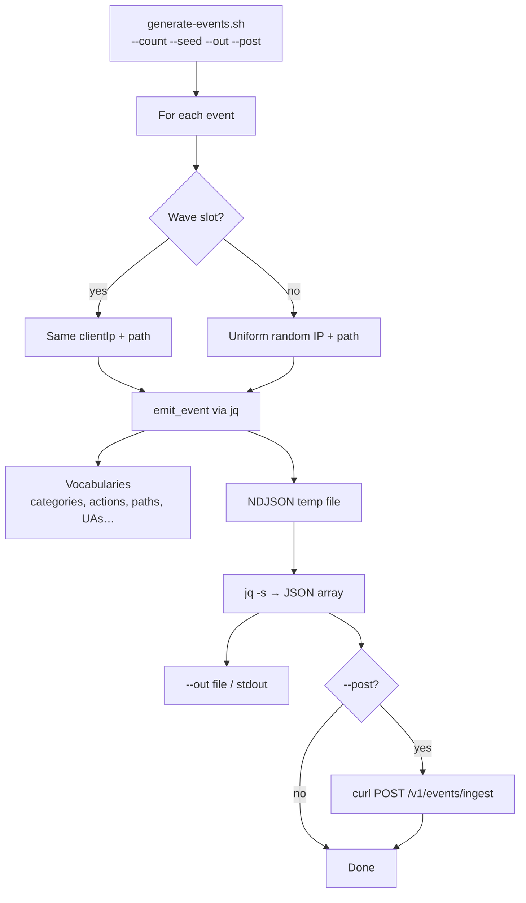

# Data generator (Part 5)

A **bash** tool under `tools/` that builds realistic-looking DLR JSON for load /
demo testing. It is **not** part of the Spring Boot app (keeps product and
tooling separate).

### Component flowchart



---

## What it does

- Emits a **JSON array** of security events matching the ingest schema
- **Uniform random** background traffic across categories / actions / paths / IPs
- **Attack waves**: every 100 events, a burst of 25 sharing the same `clientIp` + `path`
- Optional **`--post`** to `POST /v1/events/ingest`
- **`--seed`** for reproducible runs (RANDOM advanced in-process, not in subshells)

---

## Usage

```bash
# 10k events to a file
./tools/generate-events.sh --count 10000 --seed 42 --out /tmp/events.json

# Feed the API (app must be running)
curl -sS -X POST http://localhost:8080/v1/events/ingest \
  -H 'Content-Type: application/json' \
  --data-binary @/tmp/events.json

# Or generate and POST in one step (still writes --out if set)
./tools/generate-events.sh --count 500 --seed 1 --out /tmp/events.json --post
```

| Flag | Default | Meaning |
|---|---|---|
| `--count N` | `1` | How many events |
| `--seed N` | unset | Seed `RANDOM` |
| `--out FILE` | stdout | Output path |
| `--post` | off | POST body to ingest |
| `--url URL` | `http://localhost:8080/v1/events/ingest` | Target when `--post` |

Dependencies: `bash`, `jq`, and `curl` when using `--post`.

---

## How “realistic” is built

- Vocabularies for paths, hosts, UAs, geos, methods
- `category` → fixed `rule.id` / `name` / `message`
- `action` → plausible `statusCode` (DENY → 403)
- Timestamps spread over a 24h window
- Waves for correlated attacker behavior (stats / repeat-offender)

---

## Verify

```bash
./tools/test-generate-events.sh
```

Checks: schema-shaped single event, count/seed determinism, wave burst ≥ 25,
`--post` against a short-lived local mock.

---

## Status

Part 5 complete (`v0.5-generator`). Remaining submission piece: top-level
`README.md` (build/run, API, architecture, storage justification, improve /
challenges — raw material in `docs/`).
