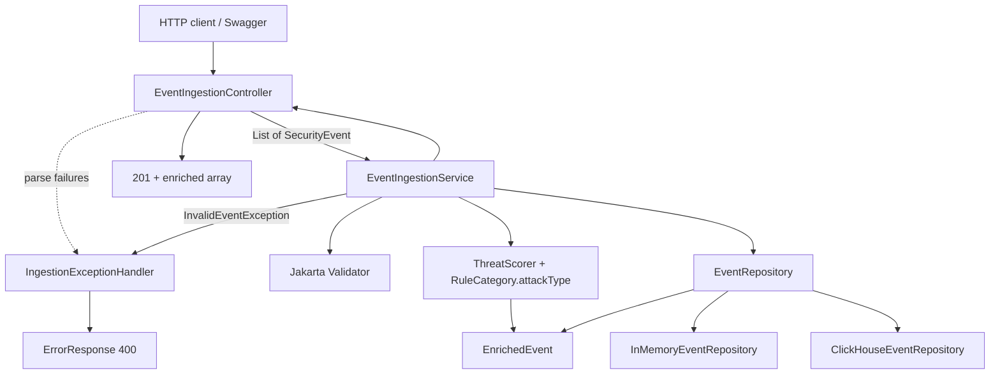

# Ingestion (Part 1)

The entry point of the Mini WSA pipeline: receive security events (DLRs) over REST,
reject anything that isn't trustworthy, enrich what's clean, and store it. This
document covers the ingestion endpoint and the pipeline it drives; the enrichment
logic itself (classification + threat score) is detailed in
[`enrichment.md`](enrichment.md).

> Pipeline position: **ingest → enrich → store** — all wired and complete.

### Component flowchart



---

## Endpoint

```
POST /v1/events/ingest
Content-Type: application/json
```

- Accepts **a single event object or an array** (batch) of events.
- **`201 Created`** with a JSON **array** of the stored *enriched* events (a single
  event comes back as a 1-element array).
- **`400 Bad Request`** with a consistent error body on any invalid input. For batches,
  **validation is all-or-nothing**: if any event is invalid, the whole request is rejected
  and **nothing** from that request is stored (no partial success, no “N−1 saved”).
  See [Batch semantics](#batch-semantics) below.

OpenAPI/Swagger is served alongside:

| Endpoint | Purpose |
|---|---|
| `GET /swagger-ui/index.html` | Interactive API UI |
| `GET /v3/api-docs` | OpenAPI 3 spec (JSON) — includes the schema and enum values |
| `GET /v3/api-docs.yaml` | Same spec in YAML |

---

## Architecture

Dependencies point **downward** only. The core never imports the web layer; storage
and enrichment are reached only through their types.

```
┌──────────────────────────────────────────────────────────────────┐
│  TRANSPORT (web)                                                   │
│  EventIngestionController   POST /v1/events/ingest (List in/out)   │
│  IngestionExceptionHandler  @RestControllerAdvice → 400s           │
│  ErrorResponse, ValidationError   (the HTTP error contract)        │
├──────────────────────────────────────────────────────────────────┤
│  APPLICATION / CORE                                                │
│  EventIngestionService.ingest(...)  ← validate → enrich → store    │
│  InvalidEventException                                             │
├──────────────────────────────────────────────────────────────────┤
│  ENRICHMENT                 │  STORAGE (seam)                      │
│  ThreatScorer               │  EventRepository (interface)         │
│  RuleCategory.attackType()  │  InMemoryEventRepository             │
│  (see enrichment.md)        │  (@Repository, ConcurrentHashMap)    │
├──────────────────────────────────────────────────────────────────┤
│  DOMAIN (cross-cutting)                                            │
│  SecurityEvent, Rule, GeoLocation, EnrichedEvent  (records)        │
│  RuleCategory, Severity, Action                   (enums)          │
└──────────────────────────────────────────────────────────────────┘

Bootstrap: MiniWsaApplication (@SpringBootApplication)
```

---

## Request flow

```
HTTP JSON  (a single object OR an array)
   │
   ▼
[1] EventIngestionController.ingest(@RequestBody List<SecurityEvent>)
   │        Jackson binds; a lone object → 1-element list
   │        (spring.jackson…accept-single-value-as-array)
   │        enums / timestamps that can't be typed fail here
   │
   ├─ parse fails ──► HttpMessageNotReadableException
   │                     └─► handler → 400 {errors:[{field,message}]}   ① transport
   │                         (field is indexed, e.g. "[0].rule.category")
   ▼
[2] ingestionService.ingest(events)
   │        validate EVERY event first (Validator)
   │
   ├─ any violation ──► InvalidEventException(List<ValidationError>)
   │                     └─► handler → 400 {errors:[...]}               ② semantic
   │                         (atomic: nothing has been stored)
   ▼
[3] all valid → for each event:
   │        enrich  (attackType + threatScore + receivedAt — see enrichment.md)
   │        save    (EventRepository)
   ▼
[4] Controller → 201 Created, body = array of EnrichedEvent
```

### Batch semantics

**Validation all-or-nothing (by design).** `EventIngestionService` validates every event in
the list before calling `save` on any of them. One bad row in a seven-event batch → **`400`**
and **zero** rows persisted from that HTTP request. The client does not get a mixed outcome
for validation failures.

**Persistence is not one transaction.** After all events pass validation, they are enriched
and saved sequentially. A store error on event 7 can leave events 1–6 already written; the
client usually sees **`500`**. Retries then depend on `eventId` / profile semantics
([`storage.md`](storage.md)).

| Outcome | HTTP | Stored from this request |
|---|---|---|
| Any event invalid or unparseable | `400` | None |
| All valid, every save succeeds | `201` | All |
| All valid, save fails partway | `500` | Possibly some (not all-or-nothing) |

### Validation — three checks, one error shape

| Check | Where | Catches |
|---|---|---|
| ① Transport | `IngestionExceptionHandler` (`HttpMessageNotReadableException`) | unknown enum, bad timestamp, unknown/extra field, malformed JSON — things Jackson rejects *before* the core runs |
| ② Semantic — presence | core `Validator` (`@NotBlank`/`@NotNull`) | missing/blank required fields, null nested objects |
| ② Semantic — numeric | core `Validator` (`@NotNull` + `@Positive`/`@PositiveOrZero`) | `configId`/`statusCode`/`requestSize`/`responseSize` — **boxed** types so an *omitted* number isn't silently `0` |

All converge on one body via the `@RestControllerAdvice`:

```json
{ "errors": [ { "field": "[0].rule.category", "message": "must be one of [INJECTION, XSS, ...]" } ] }
```

Validation lives in the **core service**, not the controller, so every entry path
(REST now; the Part 5 generator or a future queue later) is covered.

---

## Components

### Domain (`com.akamai.miniwsa.domain`)
- `SecurityEvent` — the DLR (record); Bean Validation constraints on required fields,
  with numeric fields **boxed** (`Long`/`Integer`) so presence is enforceable; cascades into `Rule`.
- `Rule`, `GeoLocation` — nested records.
- `EnrichedEvent` — original event + `attackType` + `threatScore` + `receivedAt` (see enrichment.md).
- `RuleCategory`, `Severity`, `Action` — closed enums.

### Core (`com.akamai.miniwsa.ingest`)
- `EventIngestionService` — the ingestion operation (single `ingest(event)` and batch
  `ingest(List)`). Validates, enriches (via `ThreatScorer` + `RuleCategory.attackType()`),
  and stores (via `EventRepository`). The trust boundary.
- `InvalidEventException` — carries `List<ValidationError>`; the "rejected" signal.

### Transport (`com.akamai.miniwsa.ingest`)
- `EventIngestionController` — thin `@RestController`; binds `List<SecurityEvent>`,
  delegates to the service, returns `201` with `List<EnrichedEvent>`.
- `IngestionExceptionHandler` — `@RestControllerAdvice`; maps semantic *and* transport
  failures to `400` under one shape.
- `ErrorResponse` (`{ errors: [...] }`) and `ValidationError` (`{field, message}`).

### Enrichment (`com.akamai.miniwsa.enrichment`)
- `ThreatScorer` — the scoring formula; `RuleCategory.attackType()` — the classification. See enrichment.md.

### Storage (`com.akamai.miniwsa.storage`)
- `EventRepository` — the swappable seam. Ingest uses `save`, `findAll`,
  `countByClientIpSince`; stats/samples methods are listed in [`storage.md`](storage.md).
- `InMemoryEventRepository` — `@Repository`, `ConcurrentHashMap<String, EnrichedEvent>`
  keyed by `eventId` (thread-safe; **idempotent upsert** — replays overwrite).
  ClickHouse is append-only (see storage).

### Bootstrap
- `MiniWsaApplication` — `@SpringBootApplication` entry point.

---

## Design decisions (headlines)

- **Typed, immutable domain** (records + enums): deserialization enforces closed value sets.
- **Zero-trust validation in the core**, not the controller.
- **Numeric fields boxed** so an omitted number can't slip through as `0`.
- **Unified error contract** for every `400`, transport or semantic.
- **Single-or-array binding** via `accept-single-value-as-array`, keeping all binding (and
  thus transport error handling) at the Jackson boundary.
- **Always an array response**; batch **validation** all-or-nothing (invalid → store nothing).
- **Idempotent upsert by `eventId` on the in-memory profile** (at-least-once edge delivery).
  ClickHouse appends rows — replays can duplicate.
- **Storage behind an interface** — in-memory default, ClickHouse on the `clickhouse` profile.

---

## Examples

**Single valid event → `201`** (1-element array, enriched):

```bash
curl -i -X POST http://localhost:8080/v1/events/ingest \
  -H 'Content-Type: application/json' \
  -d '{ "eventId":"evt-1","timestamp":"2026-05-20T14:32:10Z","configId":14227,
        "policyId":"p","clientIp":"203.0.113.42","hostname":"h","path":"/login",
        "method":"POST","statusCode":403,"userAgent":"ua",
        "rule":{"id":"1","name":"n","message":"m","severity":"CRITICAL","category":"INJECTION"},
        "action":"DENY","geoLocation":{"country":"CN","city":"B"},
        "requestSize":10,"responseSize":20 }'
# → [ { ...original fields..., "attackType":"SQL/Command Injection", "threatScore":75,
#       "receivedAt":"2026-10-24T15:08:38Z" } ]
```

**Batch** — wrap events in `[ ... ]`; response is the array of enriched events.

**Error responses → `400`** (same `{errors:[...]}` shape):

| Input | Body |
|---|---|
| blank `eventId`, missing `clientIp` | `{"errors":[{"field":"eventId",...},{"field":"clientIp",...}]}` |
| omitted `configId` / `statusCode` | `{"errors":[{"field":"configId",...},{"field":"statusCode",...}]}` |
| `rule.category:"BANANA"` | `{"errors":[{"field":"[0].rule.category","message":"must be one of [...]"}]}` |
| `timestamp:"not-a-date"` | `{"errors":[{"field":"timestamp","message":"invalid value for Instant"}]}` |
| unknown/extra field | `{"errors":[{"field":"[0].bogusField","message":"unknown field"}]}` |
| truncated JSON | `{"errors":[{"field":"body","message":"malformed JSON request body"}]}` |
| batch with any invalid event | `400`, nothing stored (atomic) |
| unexpected server error | `500` `{"errors":[{"message":"Internal server error"}]}` (cause logged, never leaked) |

---

## Tests

| Test | Covers |
|---|---|
| `SecurityEventDeserializationTest` | sample DLR JSON → typed model (enums mapped) |
| `EventIngestionServiceTest` | validation; enrich+store; repeat-offender; batch atomicity; in-memory upsert |
| `EventIngestionControllerTest` | API end-to-end: single `201`; **batch `201`**; semantic/numeric/bad-enum/malformed `400` |
| `IngestionExceptionHandlerTest` | clean `500` body (cause not leaked) |
| `InMemoryEventRepositoryTest` | store: empty on creation; save/read back; count-by-IP-since |
| `RuleCategoryTest`, `ThreatScorerTest` | enrichment (see enrichment.md) |

---

## Run

```bash
# Local (needs JDK 21 + the Maven wrapper)
./mvnw spring-boot:run

# Containerized (needs only Docker; --build picks up latest code)
docker compose up --build
```

Then open <http://localhost:8080/swagger-ui/index.html>.

---

## Known limitations / would improve

- **Empty batch** (`[]`) returns `201 []` (a no-op success) rather than a `400`.
- **No max batch size** — a very large array (e.g. 10k events) is processed in one request;
  would add a cap and return `413 Payload Too Large` past it.
- **Batch error reporting** — transport errors are indexed (`[0].rule.category`) but semantic
  errors are not (`eventId`); per-index semantic errors would be a nice addition.
- **Intra-batch duplicate `eventId`** — response always includes both enriched events.
  In-memory keeps one (response count can exceed stored); ClickHouse stores both rows.
- **Repeat-offender count race** — the count-then-save step isn't atomic, so concurrent requests from
  the same IP can momentarily under-count (a bonus missed once). Benign; a real store would do this atomically.

## Status

Parts 1–5 and the rate-limit bonus are complete. End-to-end paths:
[`system-paths.md`](system-paths.md). Residuals: [`gaps.md`](gaps.md).
