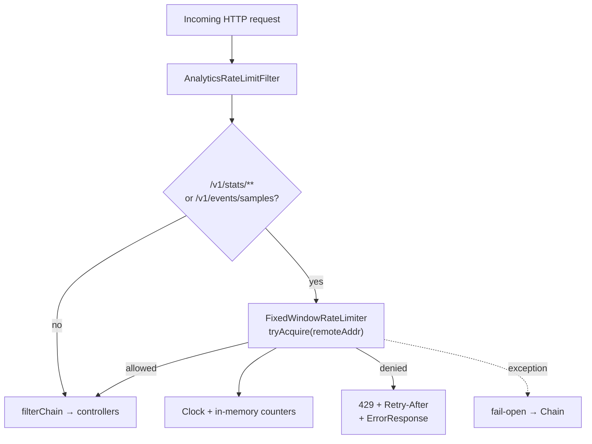

# Rate limiting (bonus)

Protects the **analytics read path** from abusive polling. Ingest is intentionally
unthrottled so demos / the data generator can load freely.

### Component flowchart



---

## Policy

| | |
|---|---|
| Paths | `/v1/stats/**`, `/v1/events/samples` (any HTTP method; exact samples path) |
| Key | Client IP (`request.getRemoteAddr()`) |
| Algorithm | Fixed window |
| Limit | **100 requests / minute / IP** (`app.rate-limit.requests-per-minute`) |
| Store | In-memory (`ConcurrentHashMap`) |
| On exceed | `429 Too Many Requests` + `Retry-After` + `ErrorResponse` body |
| On limiter failure | **Fail-open** (allow the request) |

---

## Flow

```
Request
  │
  ▼
AnalyticsRateLimitFilter     shouldNotFilter? → skip ingest / other paths
  │
  ▼
FixedWindowRateLimiter.tryAcquire(ip)
  ├── allowed → filterChain
  └── denied  → 429 + Retry-After + ErrorResponse
```

| Class | Role |
|---|---|
| `AnalyticsRateLimitFilter` | Path match, IP key, write 429 |
| `FixedWindowRateLimiter` | Per-key counter for the current minute window |
| `RateLimitConfig` | Provides `Clock` (testable) |

---

## Config

```properties
app.rate-limit.requests-per-minute=100
```

---

## Try it

With a low limit for a quick demo:

```properties
app.rate-limit.requests-per-minute=3
```

Then hit stats four times from the same client — the fourth should be `429` with
`Retry-After`.

---

## Tests

| Test | Covers |
|---|---|
| `FixedWindowRateLimiterTest` | allow / deny / per-key / window reset (`Clock`) |
| `AnalyticsRateLimitFilterTest` | HTTP 429 + header; ingest not limited |

---

## Status

Bonus rate limiting complete (`v0.6-rate-limiting`). Residuals (multi-instance,
`X-Forwarded-For`, ingest limits) stay in [`gaps.md`](gaps.md).
