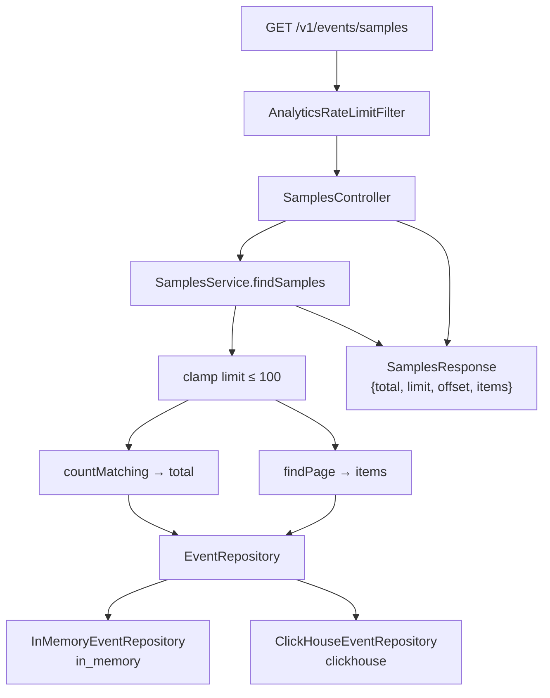

# Samples (Part 4)

Paginated retrieval of stored enriched events with optional filters. Filtering,
sorting, and paging run **in the store** (same Y choice as stats); `SamplesService`
assembles the envelope.

### Component flowchart



---

## Endpoint

`GET /v1/events/samples`

| Param | Required | Default | Meaning |
|---|---|---|---|
| `configId` | no | all configs | Filter by configuration |
| `from`, `to` | no | unbounded | Inclusive range on event **`timestamp`** |
| `category` | no | any | `RuleCategory` enum name |
| `action` | no | any | `Action` enum name |
| `limit` | no | `20` | Page size; **upper-clamped** to max `100` (no floor — negatives are invalid) |
| `offset` | no | `0` | Skip this many matching rows (negatives not validated) |

Sort: `timestamp` descending (newest first). Bad ISO-8601 → `400`.

---

## Response envelope

```
{ total, limit, offset, items: [ EnrichedEvent, ... ] }
```

- `total` — full match count (for pagination UI), from `countMatching`
- `limit` — **effective** page size after clamp (not the raw query param if it was > 100)
- `items` — current page from `findPage`

---

## Architecture

```
Client
  │  GET /v1/events/samples?...
  ▼
SamplesController        optional params; Instant.parse when from/to present
  │
  ▼
SamplesService           clamp limit; call countMatching + findPage
  │
  ▼
EventRepository
  ├── countMatching(...)
  └── findPage(..., limit, offset)   // ORDER BY timestamp DESC
```

| Layer | Classes |
|---|---|
| API | `SamplesController` |
| Service | `SamplesService` |
| DTO | `SamplesResponse` |
| Store | `countMatching` / `findPage` on both repository impls |

---

## Design decisions

- **Optional `from`/`to`** — unlike stats; null bound = open-ended (assignment: all filters optional).
- **JSON envelope** — clearer pagination contract than a bare array + header.
- **Two repo methods** — count and page stay independent; mirrors stats-style granular queries.
- **Clamp `limit > 100`** — silent cap (not `400`); response `limit` shows what was applied.
- Time filter on **`timestamp`**, aggregation/filter in the **repository** (consistent with Part 3).

---

## Try it

```
GET /v1/events/samples?configId=14227&from=2026-05-20T00:00:00Z&to=2026-05-21T00:00:00Z&category=INJECTION&action=DENY&limit=20&offset=0
```

Omit time/filters for “everything” (fine for in-memory; watch cost on ClickHouse at scale).

---

## Tests

| Test | Covers |
|---|---|
| `InMemoryEventRepositoryTest` | optional from/to; category/action; findPage order + offset |
| `ClickHouseEventRepositoryTest` (`-Pintegration`) | same contract |
| `SamplesControllerTest` | envelope, items, clamp, category/action via HTTP |

---

## Status

Part 4 complete (`v0.4-samples`). Part 5 generator: [`generator.md`](generator.md).
Rate-limit bonus: [`rate-limiting.md`](rate-limiting.md) (`v0.6-rate-limiting`).
End-to-end: [`system-paths.md`](system-paths.md). Residuals in [`gaps.md`](gaps.md).
