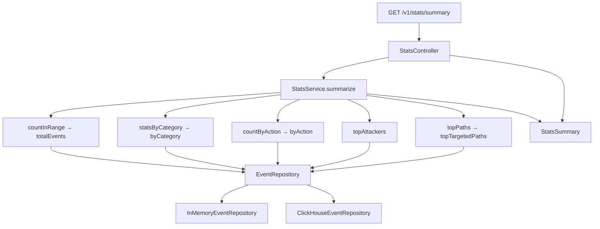

# Stats (Part 3)

Analytics over stored enriched events. One endpoint returns a full summary for a
configuration (optional) and time range, with aggregations computed **in the store**
(ClickHouse SQL / in-memory streams) and assembled by `StatsService`.

### Component flowchart



---

## Endpoint

`GET /v1/stats/summary?configId={configId}&from={ISO8601}&to={ISO8601}`

| Param | Required | Meaning |
|---|---|---|
| `from`, `to` | yes | Inclusive range on the event **`timestamp`** (not `receivedAt`) |
| `configId` | no | Omit to aggregate across all configurations |

Bad ISO-8601 → `400` via `IngestionExceptionHandler` (`ErrorResponse`). Missing required
`from`/`to` → Spring's default `400` body (not our shape — see [`gaps.md`](gaps.md) #13).
Empty range → zeros / empty maps / empty lists. Categories and actions with zero events are
omitted from the maps (not zero-filled).

---

## Response shape

```
configId, timeRange { from, to }, totalEvents,
byCategory { CATEGORY → { count, avgThreatScore } },
byAction { ACTION → count }   // only actions present in the window

topAttackers [ { clientIp, count, avgThreatScore } ]   // top 10 by count
topTargetedPaths [ { path, count } ]                   // top 10 by count
```

---

## Architecture

```
Client
  │  GET /v1/stats/summary?...
  ▼
StatsController          parse configId / from / to
  │
  ▼
StatsService             orchestrate; fixed top-N limit = 10
  │
  ▼
EventRepository          aggregation methods (both impls)
  ├── countInRange
  ├── statsByCategory
  ├── countByAction
  ├── topAttackers
  └── topPaths
```

| Layer | Classes |
|---|---|
| API | `StatsController` |
| Service | `StatsService` |
| DTOs | `StatsSummary`, `TimeRange`, `CategoryStats`, `AttackerStats`, `PathCount` |
| Store | `EventRepository` + `InMemoryEventRepository` / `ClickHouseEventRepository` |

---

## Design decisions

- **Time filter = event `timestamp`** — forensic “what happened when,” matching SOC analytics.
  Server `receivedAt` remains for repeat-offender enrichment. Spoofability / late arrivals noted in
  `gaps.md`.
- **Aggregation in the repository (Y)** — ClickHouse does `GROUP BY` / `ORDER BY` / `LIMIT`;
  in-memory does the equivalent with streams. Keeps the ClickHouse choice honest at query time;
  `StatsService` only assembles sections.
- **Granular repo methods** — one method per summary section so each cycle could land independently
  and both backends stay in lock-step.

See also [`storage.md`](storage.md) for the dual-backend profile setup.

---

## Try it (Swagger / curl)

After ingesting events (see [`ingestion.md`](ingestion.md)):

```
GET /v1/stats/summary?configId=14227&from=2026-05-20T00:00:00Z&to=2026-05-21T00:00:00Z
```

Omit `configId` to roll up all configs.

---

## Tests

| Test | Covers |
|---|---|
| `InMemoryEventRepositoryTest` | each aggregation method (count, byCategory, byAction, topAttackers, topPaths) |
| `ClickHouseEventRepositoryTest` (`-Pintegration`) | same contract against real ClickHouse |
| `StatsSummaryControllerTest` | HTTP summary after ingest (all response sections) |

---

## Status

Part 3 complete (`v0.3-stats`). See also [`samples.md`](samples.md),
[`generator.md`](generator.md), [`system-paths.md`](system-paths.md).
Stats follow-ups in [`gaps.md`](gaps.md).
