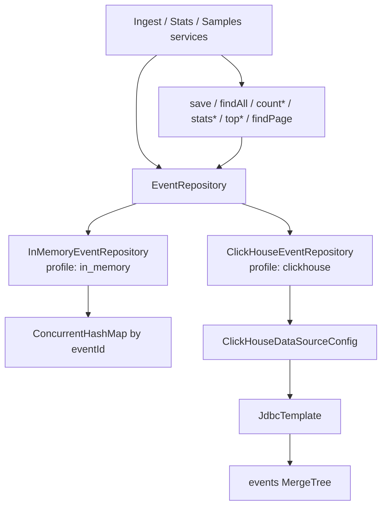

# Storage

Storage sits behind the `EventRepository` interface (the swappable seam), with two
implementations selected by Spring profile. The app stores the *enriched* event
(original fields + `attackType`/`threatScore`/`receivedAt`).

### Component flowchart



## Seam (`EventRepository`)

| Method | Used by |
|---|---|
| `save`, `findAll` | ingest |
| `countByClientIpSince` | enrichment (repeat-offender) |
| `countInRange`, `statsByCategory`, `countByAction`, `topAttackers`, `topPaths` | stats |
| `countMatching`, `findPage` | samples |

## Two implementations

| | Default (in-memory) | ClickHouse |
|---|---|---|
| Profile | `in_memory` (default via `spring.profiles.default`) | `clickhouse` |
| Class | `InMemoryEventRepository` | `ClickHouseEventRepository` |
| Backing | `ConcurrentHashMap` keyed by `eventId` | ClickHouse `events` table (`MergeTree`) |
| Duplicate `eventId` | **upsert** (last write wins) | **append** (duplicate rows kept) |
| Infra | none — always boots | ClickHouse server |
| Use | local dev, the fast test suite | production-like / the full-stack bonus |

Activate **exactly one** storage profile. `@SpringBootApplication` excludes
`DataSourceAutoConfiguration` so **`in_memory` needs no database**; the `clickhouse` profile wires
its own `DataSource` + `JdbcTemplate`
(`ClickHouseDataSourceConfig`) and creates the schema on startup.

## Profile choice (design decision)

Storage backends are **named profiles**, not a negated condition (`in_memory` and `clickhouse` —
each implementation is `@Profile("…")` on its own class).

| Question | Decision | Rationale |
|---|---|---|
| Default when nothing is set? | `spring.profiles.default=in_memory` | Clone-and-run for reviewers and local dev; `./mvnw test` and `spring-boot:run` need no Docker. |
| What runs in “real” deploy? | **`clickhouse` must be set explicitly** (e.g. `SPRING_PROFILES_ACTIVE=clickhouse` in Compose / k8s) | Production should never rely on an implicit default; env declares the backend. |
| Fail if profile omitted? | No (for this take-home) | Omitting both would leave no `EventRepository` and a confusing startup failure; default documents the happy path. A hardened service could drop the default and fail fast with a clear message. |
| Both profiles at once? | Unsupported | Spring would register two `EventRepository` beans; activate **one** profile only. |

Explicit local / CI examples:

```bash
./mvnw spring-boot:run                                    # in_memory (default)
./mvnw spring-boot:run -Dspring-boot.run.profiles=clickhouse   # needs ClickHouse reachable
SPRING_PROFILES_ACTIVE=clickhouse ./mvnw spring-boot:run
```

This is intentional configuration, not a design weakness — see [`weaknesses.md`](weaknesses.md) for
semantic debts (e.g. upsert vs append under the same interface).

## Why ClickHouse

The workload is append-heavy, immutable, time-series security events read by analytical
aggregations (stats) and filtered scans (samples) — a columnar-OLAP fit. ClickHouse is chosen over
a search engine (Elasticsearch) or a row store (Postgres) for aggregation throughput on that
workload at scale. In-memory is the zero-infra default for development.

## How to run

```bash
# in_memory (zero dependencies; spring.profiles.default)
./mvnw spring-boot:run

# ClickHouse full stack (app + ClickHouse; Compose sets SPRING_PROFILES_ACTIVE=clickhouse)
docker compose up --build
```

Credentials/URL for the app come from the environment (`SPRING_DATASOURCE_URL`, `…_USERNAME`,
`…_PASSWORD`) — set by `docker-compose.yml`. The `events` table is created on startup.

## Schema & mapping

- `events` table, `ENGINE = MergeTree ORDER BY (configId, timestamp)`, flattened columns
  (`clickhouse-schema.sql`).
- `Instant` ↔ UTC `LocalDateTime` across JDBC; enums → `name()`; null optional fields → `""`.

## Testing

- **Unit:** `InMemoryEventRepositoryTest` (fast, no infra).
- **Integration (Testcontainers, `-Pintegration`):** `ClickHouseEventRepositoryTest` (repository
  contract) and `ClickHouseIngestionIntegrationTest` (full stack: HTTP ingest → stored in ClickHouse).
  Tagged `integration` and excluded from the default `mvn test`.

## Limitations

See [`gaps.md`](gaps.md) — notably: single-row INSERTs (batching would suit ClickHouse better at
scale), no retention/TTL, null optional fields round-trip as empty strings, and ClickHouse
append-only storage (no `eventId` upsert / dedup).
