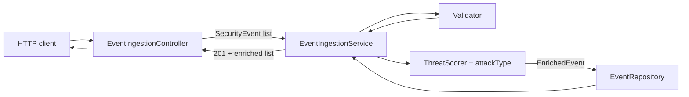
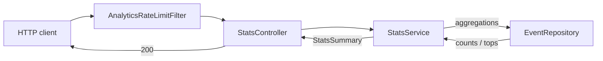
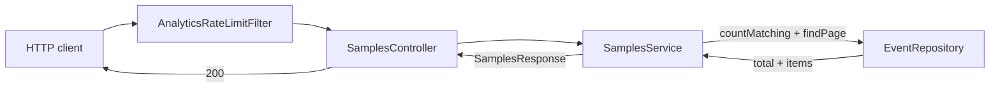
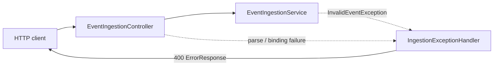
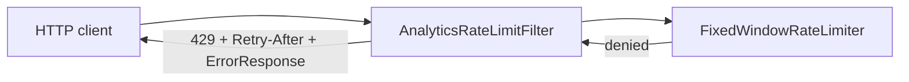
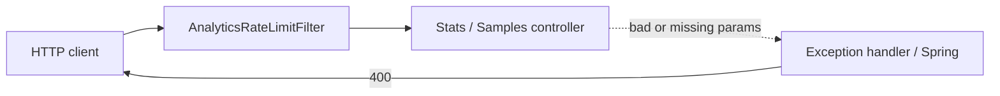

# System paths

End-to-end view of how data moves through Mini WSA. Happy paths first, then error
paths. Each path has its own chart — only the main components.

Per-step detail: [ingestion](ingestion.md), [enrichment](enrichment.md),
[storage](storage.md), [stats](stats.md), [samples](samples.md),
[rate-limiting](rate-limiting.md). Storage backends differ on duplicate
`eventId` (in-memory upsert vs ClickHouse append) — see [storage](storage.md).

---

## Happy paths

### 1. Ingest

Client posts one event or a batch. Clean events are validated, enriched, stored,
and returned as enriched records.

### 2. Stats summary

Analytics reads go through the rate-limit filter, then aggregate in the store.

### 3. Samples

Same filter gate; store filters, sorts, and pages; service builds the envelope.

---

## Error paths

### 1. Ingest rejected

Parse failure, validation failure, or semantic reject. Batch is atomic: nothing is
stored. Handler turns the exception into a consistent body.

### 2. Analytics rate limited

Only `/v1/stats/**` and `/v1/events/samples`. Ingest is not throttled.

### 3. Analytics bad query

Missing or unparseable time params (and similar binding failures) never reach a
successful summary or page.

### Error reference

| Path | Status | Emitted by | Detail |
|---|---|---|---|
| Ingest parse / validation / semantic | `400` | `IngestionExceptionHandler` | [ingestion](ingestion.md) |
| Analytics over limit | `429` | `AnalyticsRateLimitFilter` | [rate-limiting](rate-limiting.md) |
| Stats / samples bad query | `400` | Exception handler / Spring defaults | [stats](stats.md), [samples](samples.md), [gaps](gaps.md) |
