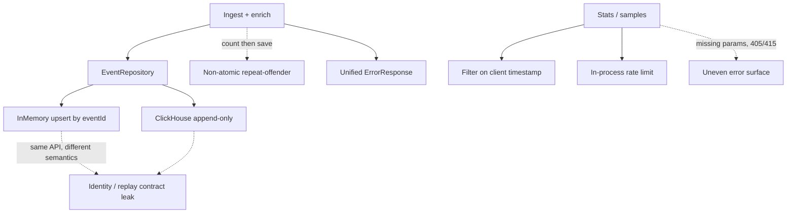

# Design weaknesses

Honest look at where the **architecture** is soft — not the full punch-list of unfinished
polish (that’s [`gaps.md`](gaps.md)). These are the trade-offs you’d defend or change first
in a design review.

### Component flowchart

Where the weak seams sit relative to the main path:

---

## How this differs from gaps

| | [`gaps.md`](gaps.md) | This page |
|---|---|---|
| Focus | Concrete behaviours not built or not hardened yet | Structural / semantic design debts |
| Example | empty batch → `201`, no IP format check | same interface, different upsert semantics |
| Use | “what I’d improve” checklist | interview / architecture discussion |

Many gap rows are *symptoms* of the weaknesses below.

---

## 1. Backend-dependent identity (highest debt)

`EventRepository` looks identical on both profiles, but:

- **In-memory** upserts by `eventId` (replay overwrites).
- **ClickHouse** appends rows (replay duplicates).

Downstream assumptions (idempotent delivery, “upsert doesn’t inflate repeat-offender”) only
hold on the `in_memory` profile. That’s a **contract leak**: one seam, two meanings.

**Would change:** make identity semantics part of the repository contract (e.g. upsert /
dedup on ClickHouse via engine choice or explicit replace), or document and test both
profiles as first-class behaviours.

See [`storage.md`](storage.md), gaps #4.

---

## 2. Enrichment not atomic with storage

Repeat-offender scoring does **count-then-save**. Under concurrency, two requests from the
same IP can both miss the bonus. On ClickHouse, duplicate inserts also inflate the count.

The threat-score story is clear for demos; soft under load or dual-backend reality.

**Would change:** atomic count+insert (or a store-side “prior count” that includes the
write), and align replay semantics with weakness #1.

See [`enrichment.md`](enrichment.md), gaps #6.

---

## 3. Analytics trust the client clock

Stats and samples filter on event **`timestamp`**, not server **`receivedAt`**.

Right for “what happened when” forensics; weak if you care about “what we observed when.”
Spoofed or late events can reshape past windows.

**Would change:** watermarking, optional `timeField` query param, or default to `receivedAt`
for operational dashboards.

See [`stats.md`](stats.md), [`samples.md`](samples.md).

---

## 4. Rate limit is a local bouncer

Fixed-window, in-process map, keyed on `getRemoteAddr()`. No shared store across replicas,
no trusted forwarded-IP story. Ingest is intentionally unlimited.

Correct for a single-node demo; not a protection model.

**Would change:** shared limiter (Redis etc.), proxy-aware client key, optional ingest caps.

See [`rate-limiting.md`](rate-limiting.md).

---

## 5. Uneven error surface

Ingest maps many failures into a consistent `ErrorResponse`. Missing required stats
params, some binding failures, and `405`/`415` still look like Spring defaults.

Callers can’t rely on one error shape across the API.

**Would change:** broaden `@RestControllerAdvice` (or dedicated handlers) so analytics and
HTTP-level errors share the ingest contract.

See gaps #11, #14.

---

## 6. “Mini” ingest trust boundary

No batch size cap, empty `[]` succeeds, loose HTTP status / IP / time sanity, path bonus is
a substring match. Fine for assignment scope; easy to surprise in a live demo or abuse at
scale.

**Would change:** treat as hardening, not a redesign — see the limitations table in
[`gaps.md`](gaps.md).

---

## One-line summary

Biggest design debt: **same repository API, different identity semantics**, plus
**non-atomic enrichment**. Most other items are hardening around an otherwise clear
receive → check → decorate → store → query pipeline.
